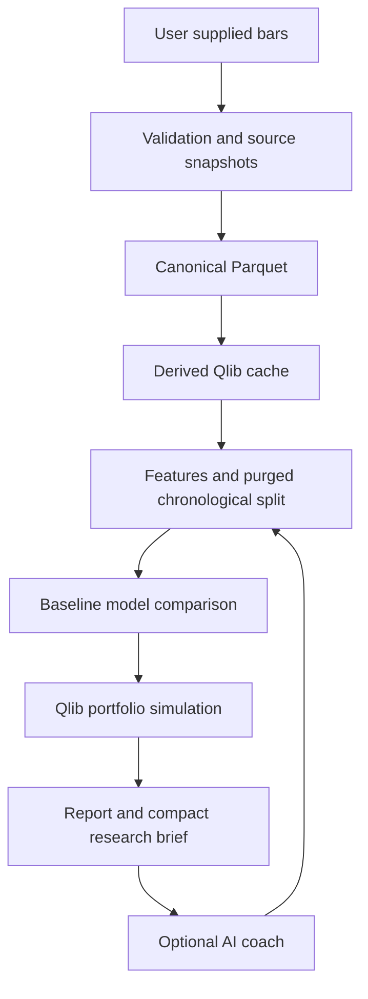

# Architecture and extension boundaries

The package is an overlay around Qlib, not a fork. Qlib 0.9.7 is pinned for a testable interface. Upstream version updates need conversion, expression, training and execution tests before changing the pin.

## Modules

- `data.py`: contract validation, content-addressed snapshots, synthetic fixtures and binary writer.
- `resources.py`: profiles and thread limits.
- `research.py`: expressions, chronological split, models, selection, Qlib simulation and manifest.
- `report.py`: escaped standalone HTML with an inline equity chart and interpretation.
- `membership.py`: NiftyHistory structural audit, independent of the portfolio.
- `cli.py`: user commands, isolated research subprocess and timeout.

No arbitrary user YAML is executed. No model files are deserialized. Feature formulas are source-controlled. No credentials are required and no model API is called.

## Companion project

[Indian_Trader_skill](https://github.com/maheshwaripn/Indian_Trader_skill) remains independently installable. This repository should eventually export versioned strategy cards and signal intents for downstream workflow/paper tooling. The current `predictions.csv` is a research artifact, not an executable order-intent contract.

Do not import private modules from the companion repository or duplicate a broker adapter in both. Agree explicit versioned contracts for symbol identity, signal timestamps, portfolio targets, provenance and evidence status before wiring execution.

## Future boundaries

Provider adapters return normalized observations and provenance. A PIT universe service returns eligibility at information time. A cost/exchange service returns dated instrument-specific rules. A paper/live execution service consumes validated intents and owns order lifecycle/reconciliation. These are planned interfaces, not implemented services.

The first release intentionally rejects incomplete pilot panels. A future dynamic-universe engine must handle listing, removal, re-entry, halts, delistings and unavailable prices without silently dropping held positions from P&L.
